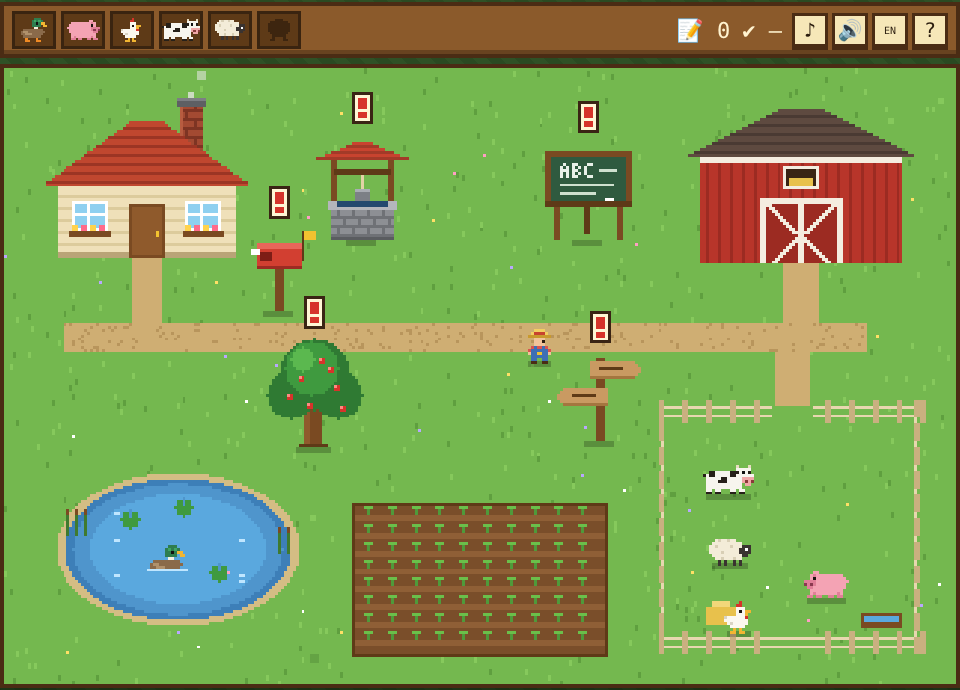
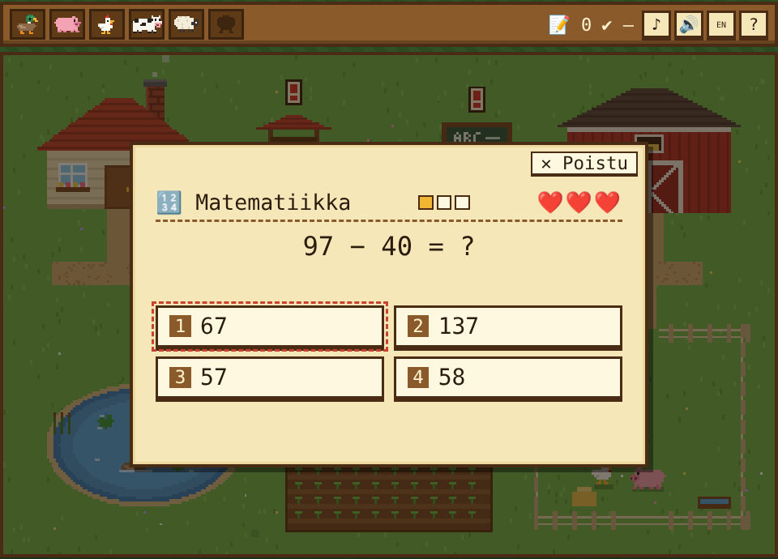

# 🐔 Farmikoulu

Retrotyylinen selainpeli 3.–6.-luokkalaisille. Tee koulutehtäviä 2D-farmilla, ansaitse arkkuja ja kerää kaikki farmin eläimet. Lopuksi odottaa Perunapomo!

**▶ Pelaa:** https://il3.github.io/farmikoulu/

## Pelin idea

- Kävele farmilla nuolinäppäimillä, WASD-näppäimillä tai napauttamalla.
- Tehtäväpisteet on merkitty ❗-merkillä. Paina **E** tai napauta pistettä.
- Saat tehtävästä arkun, kun vastaat **3 kysymykseen oikein**. Jokaisessa kysymyksessä on 4 vaihtoehtoa.
- Käytössäsi on **3 yritystä**. Väärän vastauksen jälkeen kysymys vaihtuu. Jos kaikki yritykset menevät, tehtävä alkaa alusta.
- Jokaisessa arkussa on **1 eläin**: sorsa, possu, kana, lehmä, lammas tai peruna. Ilman yhtään virhettä saat kultaisen arkun, josta tulee useammin uusi eläin.
- Kun sinulla on kaikki eläimet, pellolta nousee **Perunapomo**. Pomotaistelussa jokaisessa kysymyksessä on 20 sekunnin aikaraja. Voita pomo, niin voitat pelin!
- Jokaisesta pomovoitosta ladosta tulee hopeaperuna, ja pomon voi haastaa uusintaotteluun.
- Perunapomon voitettuasi pääset **seuraavalle farmille**, jossa on yksi iso lato ja paljon peltoa. Siellä arkuista tulee kasveja: vehnä, porkkana, kurpitsa, mansikka, maissi ja auringonkukka. Kasvata kaikki pellot täyteen!
- Kun olet tehnyt tehtävän jokaisella pisteellä, farmin keskelle ilmestyy salaperäinen kivi, josta tehtävät voi nostaa 7.–8. luokan tasolle.

## Oppiaineet

| Tehtäväpiste | Oppiaine |
|---|---|
| 🪣 Kaivo | Matematiikka: kertotaulu, jako-, yhteen- ja vähennyslasku |
| 📮 Postilaatikko | Äidinkieli |
| 🟩 Liitutaulu | Englanti |
| 🍎 Omenapuu | Ympäristöoppi |
| 🪧 Tienviitta | Historia ja maantieto |

Tasot: 3.–4. luokka, 5. luokka, 6. luokka ja avattava 7.–8. luokka. Taso koskee kaikkia aineita. Pelin kieleksi voi valita suomen tai englannin.

## Tekniikka

- Koko peli on yksi tiedosto, `index.html`, jossa on HTML, CSS ja JavaScript. Se ei tarvitse asennuksia eikä palvelinta.
- Grafiikka on piirretty koodilla pikseli kerrallaan canvasiin.
- Musiikki ja äänet tehdään Web Audio API:lla suoraan selaimessa.
- Edistyminen tallentuu selaimen localStorageen.
- Fontit: Press Start 2P ja VT323 (Google Fonts).

Pelin voi pelata myös ilman nettiä: lataa `index.html` ja avaa se selaimessa.

**Tekijä:** leetu1234. Peli on tehty Clauden avulla.

---

## English

**Farmikoulu** ("Farm School") is a retro browser game for grades 3–6. Do school tasks on a 2D farm, earn chests, collect every farm animal and finally beat the Potato Boss. The game is available in Finnish and English. **Play:** https://il3.github.io/farmikoulu/

Made by **leetu1234**.
